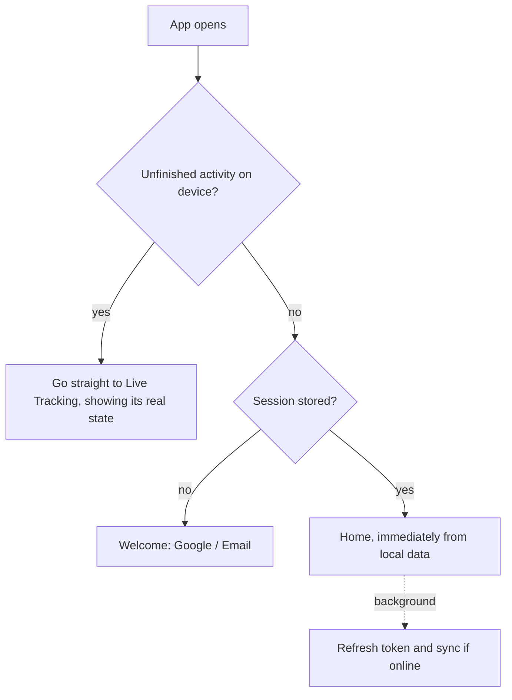
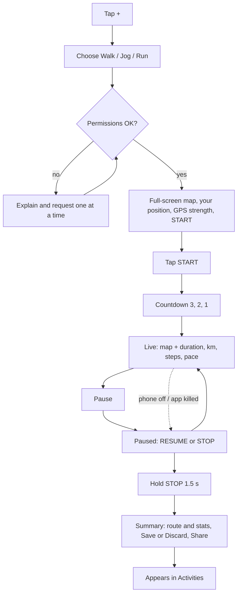

# 01. Product Scope and Flows

## In scope

- Sign in with Google, or email + password with OTP verification
- Track walk, jog, run: map, duration, distance, steps, pace, with pause and stop
- Home: activity heatmap, chart with filters, + button
- Activities list and detail
- Share studio with full customization
- Offline use and cloud backup

## Out of scope (on purpose)

Calories, heart rate, wearables, goals, coaching, social feed, followers, segments, leaderboards, audio cues, route planning.

## Navigation

```
(auth)   Welcome → Sign in / Register → Verify OTP → Forgot password
(tabs)   Home | Activities | Settings          + button floats on Home
(modals) Track setup → Live tracking → Summary → Share studio
         Activity detail → Share studio
```

Three tabs only.

## Flow 1: Opening the app



- **Unfinished activities are checked first, even before login.** A recording is never hidden behind a login screen.
- An expired login or no internet **never blocks Home or tracking**. It only pauses sync, shown as a small "Sign in to back up" banner.
- First-time sign-in does need internet, which is the one exception.

## Flow 2: Registration

1. Enter name, email, password
2. A 6-digit OTP is emailed (valid 10 minutes, resend after 60 seconds)
3. Enter OTP → account created → signed in

Forgot password follows the same OTP flow. Details are in [08-backend-and-auth.md](08-backend-and-auth.md).

## Flow 3: Home

Top to bottom:

1. **Heatmap:** last 12 months of day squares, scrolls horizontally, opens on the current week. Color strength follows the selected metric. Tap a day to see that day's activities.
2. **Chart filters:**
   - Metric: `Active time` | `Distance` | `Steps` | `Sessions`
   - Range: `Week` | `Month` | `Year`, with previous and next arrows
   - Type: `All` | `Walk` | `Jog` | `Run`
3. **Bar chart:** default is this week, active time, all types.
4. **Totals row** for the selected range.
5. **+ button**, fixed at bottom right. It opens a sheet with **Track walk**, **Track jog**, **Track run**.

All values are queried from local SQLite, so Home opens instantly, offline. Rows update automatically when a new activity is imported.

Each activity stores the **local date on which it started**, so stats don't shift when you travel across time zones. First day of the week is a setting (default Monday).

## Flow 4: Tracking (your exact flow)



Details:

- **Weak GPS doesn't block START.** It shows "Acquiring GPS". Time and steps run while the GPS locks on.
- **The GPS warms up during the countdown** so the first meters aren't lost. Nothing is counted until the countdown reaches zero.
- **Stop needs a 1.5-second hold** so a pocket tap can't end an activity. Pause is one tap.
- **Discard needs a second confirmation** because it's the only way a recording can be deleted at this point.
- **No auto-pause.** It adds a source of wrong durations, and you asked for a simple tracker. Pause is always your choice or the result of a real interruption.
- **Lock-screen notification** shows the live timer and distance, with Pause and Resume buttons, so you don't need to open the app.

### Permissions, asked only when first needed

| Permission | Why | If denied |
|---|---|---|
| Location (Precise, While Using) | Route and distance | Can't start. Explains how to enable it |
| Notifications (Android 13+) | Recovery alerts and lock-screen controls | Tracking works, but recovery alerts are silent. Warn once |
| Physical activity / Motion | Steps | Tracking works, steps show as "—" |
| Battery optimization exemption (Android) | Stops the OS killing tracking | Tracking works, but with higher risk. Show phone-brand-specific guidance |

**"Allow all the time" location isn't requested.** A foreground service started while the app is visible keeps its location access when the screen is locked, so the more invasive permission isn't needed.

## Flow 5: Recovery after an interruption

When the phone restarts or the app was killed:

- A notification appears where possible: "Your walk is paused. Tap to continue."
- Opening the app goes straight to the paused screen, explaining why: "Paused at 6:42 pm because your phone switched off."
- You choose **Resume** or **Stop & save**.
- A new activity can't start until the paused one is resolved. The + button goes to it instead.

## Flow 6: Activities

- **List:** newest first, with a small route thumbnail, type, date, duration, distance. Filter by type. Small icon if not yet backed up.
- **Detail:** large map, all stats, splits per km, plus Share, Edit (title, type, note) and Delete.
- **Delete** asks for confirmation and shows Undo for several seconds. It's synced as a deletion marker.

## Flow 7: Share

Available from Summary and Activity Detail. See [06-share-studio.md](06-share-studio.md).

## Settings

Units (km / mi), first day of week, default activity map style, saved share presets, battery setup guide, backup status with "Sync now", tracking diagnostics, export all as GPX, sign out, delete account.

**Sign out is blocked if there's unsynced data**, unless you explicitly accept the warning. It's also blocked during an active recording.

## Metric definitions

| Metric | Definition |
|---|---|
| Duration (active time) | Sum of active segments. Paused or interrupted time isn't counted |
| Elapsed time | Stop time minus start time, including pauses. Shown only in detail |
| Distance | Sum of filtered GPS movement inside active segments. Gaps aren't bridged |
| Steps | Sum of step counter differences inside active segments. Blank if unavailable |
| Average pace | Active time / distance |
| Current pace | Rolling average over the last ~30 seconds, not shown until enough data exists |
