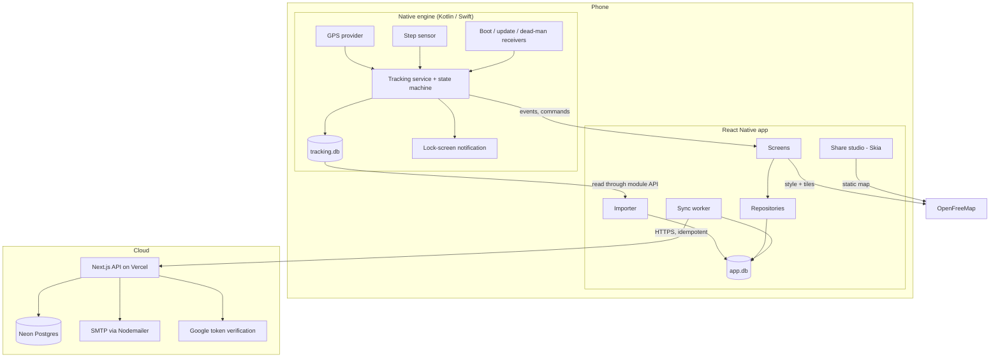

# 03. System Architecture

## Principle

Reliability comes from **keeping critical paths independent**. Each layer can fail without affecting the one before it:

| If this fails... | ...this still works |
|---|---|
| React Native UI crashes | Native engine keeps recording |
| Map tiles are down | Tracking and stats. Route draws on a plain background |
| No internet / backend / Neon down | Tracking, history, stats, sharing (route only, unless tiles are cached) |
| Login expired | Everything local. Only backup waits |
| Sync bug | Activities remain safe locally. Outbox retries after the fix ships |

## Whole system



## Data ownership rules

1. **The native engine is the only code that touches `tracking.db`.** JS asks for data through the module API. So there's no shared schema between two languages and no write contention.
2. **JS is the only code that touches `app.db`.**
3. **The UI state is only a view.** On every launch or return to foreground, the live screen rebuilds itself from `getSnapshot()`. The timer is calculated from stored values, never counted in JS.
4. **Screens never call the network for activity data.** They read `app.db`. Only the sync worker talks to the server.

## Repo layout

pnpm monorepo:

```
cardiomen/
├─ plan/
├─ apps/
│  ├─ mobile/
│  │  ├─ app/                     # Expo Router screens
│  │  │  ├─ (auth)/  (tabs)/  track/  activity/[id]/  share/[id]/
│  │  ├─ modules/tracking-engine/ # Local Expo Module
│  │  │  ├─ android/  ios/  src/
│  │  │  └─ fixtures/             # Shared test routes and expected metrics
│  │  └─ src/
│  │     ├─ features/
│  │     │  ├─ auth/  home/  tracking/  activities/  share-studio/  settings/
│  │     ├─ db/                   # Drizzle schema, migrations, repositories
│  │     ├─ sync/                 # Outbox, pull, retry
│  │     ├─ api/                  # Typed client with single-flight refresh
│  │     └─ ui/                   # Theme and shared components
│  └─ api/                        # Next.js
│     ├─ app/api/v1/...           # Route handlers
│     ├─ prisma/  prisma.config.ts
│     └─ src/ (auth, activities, sync, email, db)
└─ packages/
   └─ contracts/                  # Zod schemas and types, used by both apps
```

`packages/contracts` means a mismatch between app and API fails at compile time, not at runtime.

## Mobile libraries

| Purpose | Library | Note |
|---|---|---|
| Framework | Expo SDK 58, dev builds through EAS | Expo Go can't run MapLibre or the native engine |
| Navigation | Expo Router | |
| Live and activity map | `@maplibre/maplibre-react-native` v11 | Free, full style control |
| Canvas, heatmap | `@shopify/react-native-skia` | Share studio and heatmap |
| Charts | `victory-native` (Skia-based) | Weekly bars |
| Gestures and animation | Reanimated, Gesture Handler | Countdown, studio editing |
| Bottom sheets | `@gorhom/bottom-sheet` | + menu, studio panels |
| Local DB | `expo-sqlite` + Drizzle | Migrations and typed queries |
| UI state only | Zustand | Never stores activity data |
| Secure tokens | `expo-secure-store` | |
| Google login | `@react-native-google-signin/google-signin` | |
| Photos | `expo-image-picker`, `expo-image-manipulator` | |
| Saving and sharing | `expo-media-library`, `expo-sharing` | |
| Background sync | `expo-background-task`, NetInfo | Best effort only; foreground sync is also triggered |
| Crash reports | Sentry | Includes native crashes |

Pin exact versions. Upgrade Expo deliberately, never in the middle of a feature, and re-run the reliability suite after every upgrade.

## Backend

Next.js route handlers only, with no web UI. Stateless, so a cold start costs only a small delay and the sync worker retries anyway.

No Redis, queues, object storage or microservices. One user and small payloads don't need them, and every extra service is another way to fail. Add one only when a measured need appears.

| Concern | Decision |
|---|---|
| Validation | Zod from `packages/contracts` |
| DB access | Prisma with `PrismaNeon` on the pooled URL |
| Migrations | `prisma migrate deploy` on the direct URL, in a CI step before deploy |
| Rate limits | Postgres table, only on auth endpoints |
| Scheduled cleanup | Daily Vercel Cron: expired OTPs and refresh tokens |
| Route storage | `bytea` in Neon. Estimated ~30 KB per hour of activity (verify in spike), so a daily user adds tens of MB per year. Object storage isn't needed |

## Design system (minimal)

Dark and light mode, one accent color, one typeface with tabular numbers so timers don't jump, large touch targets on the tracking screen, and big readable stats in daylight. Keep the screen awake is an option during tracking, and map rendering stops whenever the screen is off.
