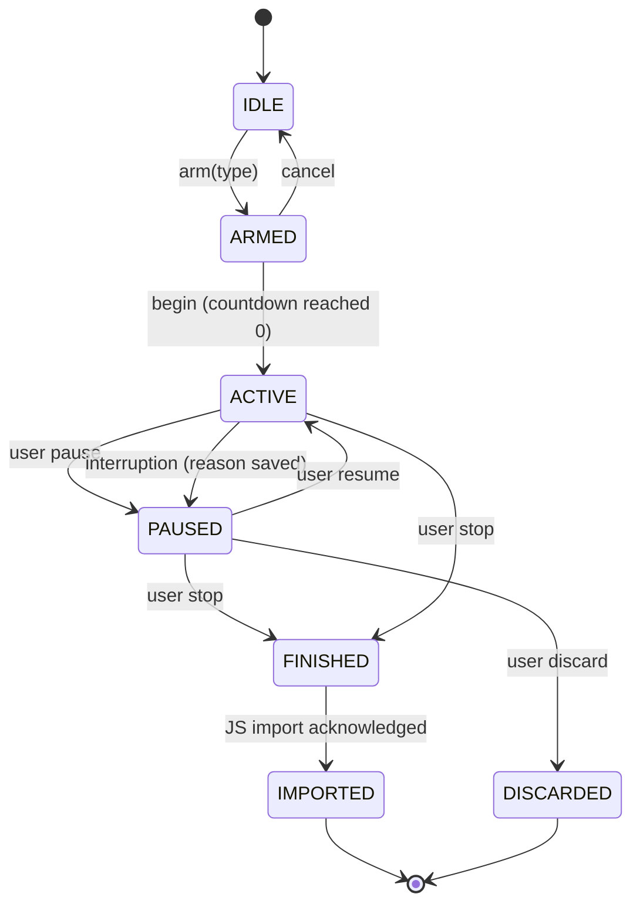
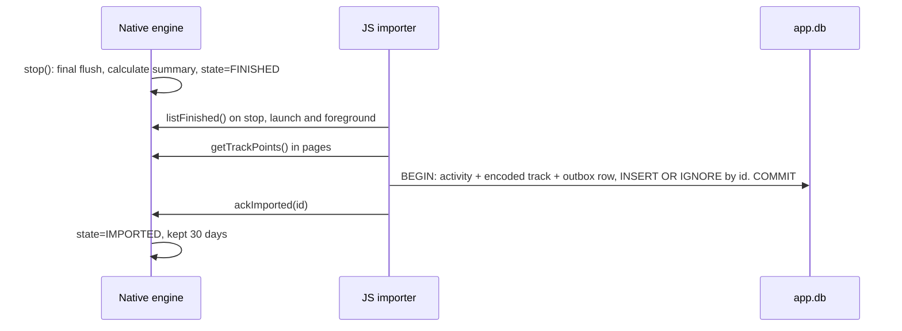

# 04. Tracking Engine

This is the most important part of the app. It's a local Expo Module with one Android and one iOS implementation behind a single API.

## Rules

1. Every state change is written to disk **before** it's acted on.
2. The engine never needs JS, the network, a login, or the map.
3. Only the user can end an activity.
4. Any unexpected stop becomes a saved pause with a recorded reason.
5. Raw GPS points are always kept, so distance can be recalculated if the filter improves.

## State machine



**Pause reasons:** `user`, `device_shutdown`, `process_killed`, `app_updated`, `permission_revoked`, `unknown`.

If the process dies but GPS can restart immediately, the activity keeps going as `ACTIVE`, with a gap recorded in the route. See "Recovery" below.

## Native API

```ts
type ActivityType = 'walk' | 'jog' | 'run';
type EngineState = 'IDLE' | 'ARMED' | 'ACTIVE' | 'PAUSED' | 'FINISHED';

interface EngineSnapshot {
  sessionId: string | null;       // UUIDv7, also becomes the activity ID
  type: ActivityType | null;
  state: EngineState;
  pauseReason: string | null;
  activeMs: number;               // at snapshotTakenAtElapsedMs
  snapshotTakenAtElapsedMs: number;
  distanceM: number;
  steps: number | null;
  currentPaceSecPerKm: number | null;
  gps: 'off' | 'searching' | 'weak' | 'good';
  health: { locationPermission: boolean; gpsEnabled: boolean; batteryOptimized: boolean };
}

interface TrackingEngine {
  getSnapshot(): Promise<EngineSnapshot>;
  arm(type: ActivityType): Promise<string>; // starts service + warms GPS while the app is visible
  cancelArm(): Promise<void>;
  begin(): Promise<void>;
  pause(): Promise<void>;
  resume(): Promise<void>;
  stop(): Promise<void>;
  discard(): Promise<void>;
  getTrackPoints(sessionId: string, afterSeq: number, limit: number): Promise<TrackPoint[]>;
  listFinished(): Promise<FinishedSession[]>;
  ackImported(sessionId: string): Promise<void>;
  addListener(event: 'state' | 'tick' | 'point', fn: (e: unknown) => void): Subscription;
}
```

Commands are idempotent. Calling `pause()` twice is harmless, which also makes double taps and retries safe.

## `tracking.db` (owned by native code)

```sql
PRAGMA journal_mode = WAL;
PRAGMA synchronous = FULL;   -- commit survives power loss

CREATE TABLE session (
  id TEXT PRIMARY KEY,
  type TEXT NOT NULL,
  state TEXT NOT NULL,
  pause_reason TEXT,
  started_at_wall INTEGER,      -- ms since epoch
  tz_offset_min INTEGER,
  active_ms_banked INTEGER NOT NULL DEFAULT 0, -- total from closed segments
  segment_no INTEGER NOT NULL DEFAULT 0,
  -- checkpoint: updated every commit
  boot_id TEXT,
  last_elapsed_ms INTEGER,      -- monotonic clock, only valid with the same boot_id
  last_wall_ms INTEGER,
  segment_start_elapsed_ms INTEGER,
  distance_m REAL NOT NULL DEFAULT 0,
  steps INTEGER,
  step_baseline INTEGER,
  last_good_lat REAL, last_good_lng REAL,
  finished_at_wall INTEGER,
  engine_version INTEGER NOT NULL
);

CREATE TABLE point (
  session_id TEXT NOT NULL,
  seq INTEGER NOT NULL,
  segment_no INTEGER NOT NULL,
  t_wall INTEGER NOT NULL,
  lat REAL NOT NULL, lng REAL NOT NULL,
  accuracy_m REAL, altitude_m REAL, speed_mps REAL,
  accepted INTEGER NOT NULL,     -- passed the distance filter?
  PRIMARY KEY (session_id, seq)
) WITHOUT ROWID;

CREATE TABLE event (              -- append-only history, used for debugging
  session_id TEXT NOT NULL,
  seq INTEGER NOT NULL,
  t_wall INTEGER NOT NULL,
  kind TEXT NOT NULL,             -- begin, pause, resume, gap, gps_lost, restart_failed...
  detail TEXT,
  PRIMARY KEY (session_id, seq)
) WITHOUT ROWID;
```

**Write pattern:** points are buffered in memory and committed in one transaction **every 3 seconds**, and immediately on pause, stop or shutdown. The transaction updates points and the checkpoint together, so they can't disagree. This limits both the worst-case loss (~3 seconds) and flash wear / battery cost compared to syncing every point.

**Retention:** rows are kept for 30 days after import as a safety copy, then removed. Before `arm()`, the engine checks for at least 50 MB free and warns if lower.

## Time calculation

- **Within a boot**, use the monotonic clock (`elapsedRealtimeNanos` on Android, the equivalent on iOS). Changing the phone's clock or time zone has no effect.
- `activeMs = active_ms_banked + (now_elapsed - segment_start_elapsed)`.
- **After an unexpected stop**, the segment closes using the last saved checkpoint. So downtime isn't counted, and at most ~3 to 5 seconds of real activity is lost from the total.
- A reboot is detected by comparing `boot_id`. On Android this comes from `Settings.Global.BOOT_COUNT`, on iOS from the system boot time. Monotonic values from a previous boot are never subtracted from current ones.

The JS timer only displays `activeMs + (nowElapsed - snapshotTakenAtElapsedMs)`, so it can't drift away from the engine.

## Android implementation

| Piece | Detail |
|---|---|
| Service | Foreground service, `foregroundServiceType="location"`, `stopWithTask="false"`, runs in the main app process |
| Starting it | `arm()`, called while the app is visible, as Android requires. The service stays up through the whole activity |
| Location | `FusedLocationProviderClient`, high accuracy, 1-second interval, no minimum distance, delivered on its own `HandlerThread` |
| Fallback | If Play Services are missing, use `LocationManager` GPS provider directly |
| Steps | `TYPE_STEP_COUNTER` listener, also read directly on pause and resume to set baselines |
| Wake lock | `PARTIAL_WAKE_LOCK` only while `ACTIVE`, released on pause |
| Notification | Low-importance ongoing channel, chronometer, distance, Pause / Resume / Open buttons handled natively |
| Pause behavior | GPS stays subscribed for 10 minutes so resume is instant, but points aren't recorded. After that, GPS and the service are released, leaving a plain "paused" notification |

Manifest: `ACCESS_FINE_LOCATION`, `ACCESS_COARSE_LOCATION`, `FOREGROUND_SERVICE`, `FOREGROUND_SERVICE_LOCATION`, `POST_NOTIFICATIONS`, `ACTIVITY_RECOGNITION`, `WAKE_LOCK`, `RECEIVE_BOOT_COMPLETED`, `REQUEST_IGNORE_BATTERY_OPTIMIZATIONS`.

Not requested: `ACCESS_BACKGROUND_LOCATION`, which also avoids the heaviest Play Store review.

### Android receivers

| Trigger | Action |
|---|---|
| `ACTION_SHUTDOWN` | Best effort: flush buffer, write pause with reason `device_shutdown`. Not guaranteed to run |
| `BOOT_COMPLETED` | If a session was `ACTIVE`, close the segment at the last checkpoint, set `PAUSED(device_shutdown)`, post "tap to continue". **Doesn't start GPS** |
| `MY_PACKAGE_REPLACED` | Same, with reason `app_updated` |
| Dead-man alarm | See below |

Notification dismissal: since Android 14, users can swipe away most foreground service notifications. The service continues, and the engine reposts it through a delete intent.

### Dead-man alarm

While `ACTIVE`, the service re-arms a non-exact alarm every minute to fire 3 minutes later. If the process dies, the alarm isn't renewed, so it fires, finds a stale checkpoint, and runs recovery. This catches kills that deliver no callback.

Force Stop cancels alarms and receivers. That case recovers at next app launch, which is the best any app can do.

## iOS implementation

| Piece | Detail |
|---|---|
| Background | `UIBackgroundModes: location`, `allowsBackgroundLocationUpdates = true`, `pausesLocationUpdatesAutomatically = false`, `activityType = .fitness` |
| Session | `CLBackgroundActivitySession` (iOS 17+), created at `arm()`, re-created after relaunch |
| Permission | When In Use is enough with the above |
| Steps | `CMPedometer`. It can query a past time range, so steps can be recovered more accurately than on Android |
| Storage | Same schema and write rules, using `synchronous=FULL`. Write `NSFileProtectionCompleteUntilFirstUserAuthentication` so writes work while locked |
| Dead-man | A local notification scheduled ~5 minutes ahead and re-scheduled every minute. If the app dies, it fires: "Your walk is paused. Tap to continue." |

On iOS, a force-quit ends tracking and the app can't reliably relaunch itself. So recovery happens at next open. Swipe-closing the app is the one action the iOS user must avoid; onboarding says so.

## Recovery algorithm

Runs at service start, app launch, boot receiver and dead-man alarm. It's idempotent and all paths use it.

```
session = latest with state ACTIVE or PAUSED
if none → done

if state == ACTIVE and this process isn't actively recording it:
    close segment at last checkpoint (bank active time, using boot-safe rules)
    add `gap` event
    if same boot AND service is able to start location now (app visible or restart allowed):
        open new segment; state stays ACTIVE; continue
    else:
        state = PAUSED; reason = classify()
        post "tap to continue" notification

if state == PAUSED: stay paused. Wait for the user. No time limit.
```

`classify()`: boot changed → `device_shutdown`; package version changed → `app_updated`; permission now missing → `permission_revoked`; otherwise → `process_killed`.

**Must test on device (spike S1):** whether a `START_STICKY` restart can regain location on your phone. Either result is safe, as it only decides between "auto-continue with a gap" and "pause until tapped".

## GPS quality and distance

For each location update:

1. **Save it raw**, always.
2. **Reject for distance** if: accuracy worse than 25 m, timestamp older than the previous point, or implied speed above 12 m/s (~43 km/h, faster than any person).
3. **Standing-still jitter:** only add distance when movement exceeds `max(3 m, accuracy × 0.5)` from the last accepted point. The anchor stays put until then, so jitter doesn't build into phantom distance.
4. **Gaps:** on a new segment, the anchor resets. No distance is added across a pause. For a same-segment GPS loss (tunnel), distance between last and next good fix is counted only if the implied speed is plausible for the gap. The map draws that stretch dashed.

These thresholds are starting values. Tune them against real recordings on known routes ([07-reliability-and-testing.md](07-reliability-and-testing.md)). Target: within ±2% on a clear-sky known route. Phone GPS can't do much better, and worse under trees or buildings.

Pace uses active-segment points only and is hidden until ~30 seconds of good data exists.

**Kotlin and Swift must match.** Shared JSON fixtures of input points and expected outputs in `modules/tracking-engine/fixtures/` run in the unit tests of both.

## Steps across interruptions

`steps += current_counter - baseline` while `ACTIVE`. At each resume or restart, take a new baseline, so paused or off-time steps aren't counted.

The Android counter resets to 0 at reboot, handled by re-baselining at resume. If a reading goes lower than the baseline, it's treated as a reset and re-baselined, never a negative number. If no sensor or permission exists, `steps` stays null and shows "—".

## From engine to activity (the import)



Crash at any step is safe. If the crash happens before the commit, it reruns from the start. If it happens between commit and ack, the insert is ignored and the ack is retried.

## Battery

- Stop map rendering when the screen is off
- No network during tracking
- 3-second batched commits
- Wake lock only while active

Measure in spike S1 and on field tests. Planning target: an hour with the screen off uses under ~10% battery on a healthy phone. This is an estimate until measured.

## Tracking diagnostics

Settings → Tracking diagnostics shows the event log for recent sessions: gaps, pause reasons, GPS loss, kills. When something goes wrong on a real run, the cause is visible rather than guessed.
