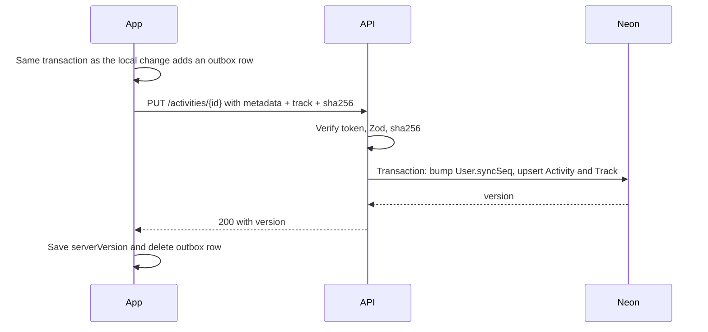

# 05. Data and Sync

## Three storage layers

| Store | Role | Can it be rebuilt? |
|---|---|---|
| `tracking.db` | Recording in progress, kept 30 days after finish | Not while recording. That's why it syncs to disk |
| `app_<userId>.db` | Everything screens read: activities, tracks, settings, outbox | Yes, from the server, except for anything still in the outbox |
| Neon Postgres | Backup and multi-device | The final safety copy |

Tiles and share previews are the only caches.

A separate `app.db` per user means signing in with a different account on the same phone never mixes data.

## `app.db` (Drizzle + expo-sqlite, WAL mode)

```ts
activities: {
  id: text PK,                 // Session UUIDv7
  type: 'walk' | 'jog' | 'run',
  title: text | null,
  note: text | null,
  startedAt: integer,          // UTC ms
  endedAt: integer,
  tzOffsetMin: integer,
  localDate: text,             // 'YYYY-MM-DD' where it started, used for heatmap and charts
  activeMs: integer,
  elapsedMs: integer,
  distanceM: real,
  steps: integer | null,
  previewPolyline: text,       // Simplified to ~200 points, for lists and thumbnails
  bboxMinLat, bboxMinLng, bboxMaxLat, bboxMaxLng: real,
  engineVersion: integer,
  updatedAt: integer,
  serverVersion: integer | null,
  deletedAt: integer | null,   // Deletion marker for sync
}
// indexes: (localDate), (deletedAt, startedAt DESC)

activity_tracks: {
  activityId: text PK,
  format: integer,             // Blob format version
  blob: blob,                  // gzip, see below
  sha256: text,
  present: integer,            // 0 means pull on demand (e.g. after reinstall)
}

share_presets: { id, name, doc: json, updatedAt, deletedAt, serverVersion }
share_drafts:  { activityId PK, doc: json, updatedAt }   // Local only
settings:      { key PK, value: json, updatedAt }
outbox:        { id PK, entity, entityId, op, attempts, nextAttemptAt, lastError, createdAt }
sync_state:    { key PK, value }  // Pull cursor
```

**Stats need no summary tables.** Heatmap and chart queries are a `GROUP BY localDate` over an indexed table. Even decades of daily activities remain a small table, so derived tables would only create a way to disagree with the real data.

```sql
SELECT localDate, SUM(activeMs) total
FROM activities
WHERE deletedAt IS NULL AND localDate BETWEEN ? AND ?
  AND (? IS NULL OR type = ?)
GROUP BY localDate;
```

## Track blob format v1

Gzip of JSON with delta-encoded integer columns:

```json
{
  "v": 1,
  "t":   [1762500000000, 1000, 1000],
  "lat": [127654321, 12, 9],
  "lng": [775912345, 8, 10],
  "acc": [5, 0, 1],
  "alt": [920, 0, 0],
  "ok":  [1, 1, 0],
  "seg": [[0, 1800], [1801, 3599]]
}
```

Coordinates are stored as degrees × 10⁷. It's simple to debug, and gzip compresses it well. Estimated ~30 KB per hour (verify with a real track in spike S1). Long activities still fit far below Vercel's request body limit (about 4.5 MB).

## Neon schema (Prisma 7)

The connection URL isn't in this file. It lives in `prisma.config.ts` and the adapter ([08-backend-and-auth.md](08-backend-and-auth.md)).

```prisma
generator client {
  provider = "prisma-client"
  output   = "../src/generated/prisma"
}

datasource db {
  provider = "postgresql"
}

enum ActivityType { WALK JOG RUN }
enum OtpPurpose   { REGISTER RESET_PASSWORD }

model User {
  id              String    @id @default(uuid(7)) @db.Uuid
  email           String    @unique          // Always lowercase
  name            String
  avatarUrl       String?
  passwordHash    String?
  googleSub       String?   @unique
  emailVerifiedAt DateTime
  syncSeq         BigInt    @default(0)      // Per-user change counter
  settings        Json      @default("{}")
  settingsVersion BigInt    @default(0)
  createdAt       DateTime  @default(now())
  updatedAt       DateTime  @updatedAt

  activities   Activity[]
  tokens       RefreshToken[]
  presets      SharePreset[]
}

// Holds unverified sign-ups. A User row exists only after OTP success.
model PendingRegistration {
  email        String   @id
  name         String
  passwordHash String
  expiresAt    DateTime
  createdAt    DateTime @default(now())
}

model EmailOtp {
  id         String     @id @default(uuid(7)) @db.Uuid
  email      String
  purpose    OtpPurpose
  codeHash   String
  attempts   Int        @default(0)
  expiresAt  DateTime
  consumedAt DateTime?
  createdAt  DateTime   @default(now())

  @@index([email, purpose, createdAt(sort: Desc)])
  @@index([expiresAt])
}

model RefreshToken {
  id           String    @id @default(uuid(7)) @db.Uuid
  userId       String    @db.Uuid
  familyId     String    @db.Uuid
  tokenHash    String    @unique
  deviceName   String?
  expiresAt    DateTime
  rotatedAt    DateTime?
  revokedAt    DateTime?
  createdAt    DateTime  @default(now())
  user         User      @relation(fields: [userId], references: [id], onDelete: Cascade)

  @@index([familyId])
  @@index([userId])
  @@index([expiresAt])
}

model Activity {
  id              String       @id @db.Uuid     // Client-generated
  userId          String       @db.Uuid
  type            ActivityType
  title           String?
  note            String?
  startedAt       DateTime
  endedAt         DateTime
  tzOffsetMin     Int
  localDate       DateTime     @db.Date
  activeMs        Int
  elapsedMs       BigInt
  distanceM       Float
  steps           Int?
  previewPolyline String
  bbox            Json
  engineVersion   Int
  clientUpdatedAt DateTime
  version         BigInt                        // User.syncSeq at last change
  deletedAt       DateTime?
  createdAt       DateTime     @default(now())
  updatedAt       DateTime     @updatedAt

  user  User           @relation(fields: [userId], references: [id], onDelete: Cascade)
  track ActivityTrack?

  @@unique([userId, version])
  @@index([userId, startedAt(sort: Desc)])
}

// Separate table so listing activities never loads route data
model ActivityTrack {
  activityId String   @id @db.Uuid
  format     Int
  blob       Bytes
  sha256     String
  activity   Activity @relation(fields: [activityId], references: [id], onDelete: Cascade)
}

model SharePreset {
  id        String    @id @db.Uuid
  userId    String    @db.Uuid
  name      String
  doc       Json
  version   BigInt
  deletedAt DateTime?
  updatedAt DateTime  @updatedAt
  user      User      @relation(fields: [userId], references: [id], onDelete: Cascade)

  @@unique([userId, version])
}

model RateLimit {
  key       String   @id
  count     Int
  resetAt   DateTime
}
```

Rule: the client always generates activity IDs, and the server checks that an existing ID belongs to the caller. If another user owns the ID, it returns 409, without revealing the owner.

## Sync protocol

Requirements: **retries are always safe, nothing is lost, and tracking is never affected.**

### When sync runs

After finishing an activity, on app foreground, on network regained, on "Sync now", and as a best-effort background task. Never needed for the app to function. Skipped while an activity is recording, to avoid using radio and battery.

### Push



If the connection dies after the server committed, the app simply retries. The same ID upserts the same row, so there are no duplicates. This is the key property.

| Response | Client action |
|---|---|
| 2xx | Done |
| 401 | Refresh token once, retry. If refresh fails, stop syncing and show "Sign in to back up" |
| 408, 429, 5xx, network error | Backoff with jitter: 30 s, 2 m, 10 m, 1 h, 6 h, then every 6 h, forever |
| 400, 409, 413, 422 | Mark the row as blocked and show it in backup status, with error attached. Keep local data. Report to Sentry. Other rows continue |

### Pull

`GET /sync/changes?cursor=<seq>` returns everything of this user's with `version > cursor`, oldest first, in pages, without track blobs. Tracks download on demand when opened or when "Restore all" runs after reinstall.

**Why a per-user counter:** a global sequence could commit out of order, so a cursor might skip a row. Incrementing `User.syncSeq` inside the transaction serializes that user's writes, so ordering is strict.

Pull applies changes inside one local transaction along with the new cursor. A row with a pending outbox entry isn't overwritten; the push goes first, then the next pull reconciles.

### Conflicts

- **Track and stats** are immutable after finish, so they can't conflict.
- **Title, type, note, settings, presets** use last-write-wins by `clientUpdatedAt`. Fine for one person.
- **Delete** wins over edits. Deleted rows stay as markers for 90 days, so all devices learn about them, and are then purged on the server.

## New phone or reinstall

Sign in → pull metadata → stats and history appear → tracks download on demand or via "Restore all".

Unsynced local data is the only data at risk if a phone is lost. Backup status makes this visible, and sync runs right after each activity to keep the window small.

## Migrations

**Local:** Drizzle migrations run at launch inside a transaction. The rule is forward-only and additive. A pre-migration file copy of `app.db` is kept until success. If a migration fails, the app shows an error rather than resetting data, and tracking still works because the engine is separate.

**Engine DB:** versioned with `PRAGMA user_version`, in native code. Never migrate while a session is active. Instead, the session finishes on the old schema version, and migration happens when idle. This is the same reason app updates during an activity result in a pause.

**Server:** expand then contract. Add new columns as optional, deploy, backfill, and only remove old ones after all app versions stop using them. API is versioned under `/api/v1`, because old app versions can stay installed for a long time.
