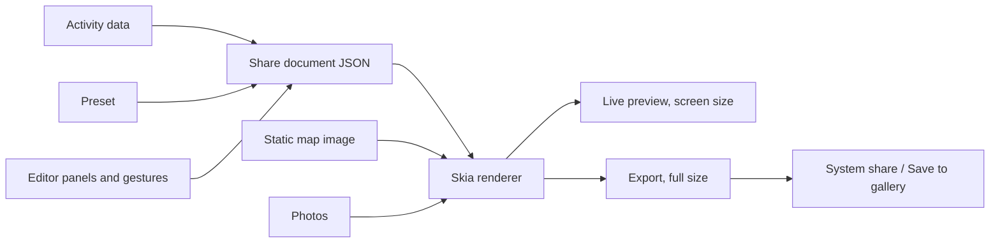

# 06. Share Studio

This is the feature that sets the app apart. The goal is for you to decide everything about the image, instead of choosing between fixed templates.

## Design

A share image is a **JSON document describing layers**. One Skia renderer draws that document, both for the live preview and the final export, so what you see is what you get. Every option is an edit to the document, which also makes undo, drafts and saved presets almost free.



## What you can customize

| Area | Options |
|---|---|
| **Ratio** | 1:1, 4:5, 3:4, 9:16, 16:9, 4:3, 3:2, or custom width:height |
| **Output size** | 1080 px standard, 2160 px high. Format PNG or JPEG |
| **Content** | Any combination of map, route, metrics, photos. So: metrics only, map only, map + metrics, photo + metrics, or map + metrics + photos |
| **Background** | Map, photo or collage, solid color, gradient, or transparent (sticker for use over Instagram stories) |
| **Map** | Theme presets, or custom colors for land, water, roads, parks. Labels on/off. Opacity. Zoom and pan. Show as full background or as a movable, resizable box |
| **Route line** | Color or gradient, width, opacity, glow, start and end markers on/off |
| **Metrics** | Choose any: distance, duration, pace, steps, date, type, title. Color per block or per item. Font, size, weight, alignment, label on/off, opacity. Drag anywhere. Layouts: row, column, grid |
| **Photos** | One or more photos, collage layouts, spacing, corner radius. Pinch and drag in each cell. Filters and adjustments per photo |
| **Text** | Free text layers |
| **Layers** | Reorder, hide, lock, delete. Snap guides. Undo and redo |
| **Privacy** | Hide the first and last 200 m of the route, and hide precise location. Off by default, with a clear prompt on first share |
| **Presets** | Save any design as your own. Apply to future activities in one tap. Remember last used |

### Collage layouts

| Photos | Layouts |
|---|---|
| 1 | Full |
| 2 | Side by side, stacked, big + small |
| 3 | 1 + 2 (four arrangements), three columns, three rows |
| 4 | Grid, 1 + 3 |
| 5 to 6 | Grid, mosaic |

Each layout is defined as data (a list of normalized rectangles), so a new layout needs no new code. The map can occupy a collage cell, just like a photo.

### Filters

Filters are Skia color matrices and take no separate library. Built in: Original, Vivid, Warm, Cool, Fade, Mono, Noir, Sepia. Sliders: brightness, contrast, saturation, warmth, vignette. Edits never alter the original photo.

## Share document

```ts
type ShareDoc = {
  version: 1;
  canvas: { ratio: { w: number; h: number }; exportWidthPx: 1080 | 2160; format: 'png' | 'jpeg' };
  background:
    | { kind: 'solid'; color: string }
    | { kind: 'gradient'; stops: { color: string; at: number }[]; angle: number }
    | { kind: 'transparent' };
  layers: Layer[];               // Order is draw order
  privacy: { trimStartEndM: number };
};

type LayerBase = {
  id: string;
  frame: { x: number; y: number; w: number; h: number; rotation: number }; // 0 to 1 of canvas
  opacity: number; visible: boolean; locked: boolean;
};

type Layer = LayerBase & (
  | { kind: 'map'; style: MapColors; showLabels: boolean; camera: 'fit' | { lng: number; lat: number; zoom: number }; cornerRadius: number }
  | { kind: 'route'; color: string; gradient?: string[]; widthPx: number; glow: number; markers: boolean; linkedMapLayerId?: string }
  | { kind: 'metrics'; items: MetricItem[]; layout: 'row' | 'column' | 'grid'; font: string; color: string; labelColor: string; align: 'start' | 'center' | 'end' }
  | { kind: 'collage'; layoutId: string; gap: number; cornerRadius: number; cells: CollageCell[] }
  | { kind: 'text'; text: string; font: string; size: number; color: string; align: 'start' | 'center' | 'end' }
);

type CollageCell = {
  source: { kind: 'photo'; localUri: string } | { kind: 'map'; layerId: string };
  crop: { offsetX: number; offsetY: number; scale: number };
  filter: { preset: string; brightness: number; contrast: number; saturation: number; warmth: number; vignette: number };
};
```

Frames are stored as fractions of the canvas, so **changing ratio doesn't break the design**. When changing ratio, layers keep their relative positions and photos and maps re-crop to fill.

Presets store the same document, with activity-specific fields (photos and map camera) stripped.

## Rendering the map

MapLibre's `StaticMapManager.createImage` makes a PNG at a given `center`, `zoom`, `width`, `height` and `mapStyle`.

### Keeping the route exactly on the roads

The route is drawn by Skia, on top of the map image. So changing the route color is instant and needs no new map. To line them up:

1. **We calculate center and zoom ourselves**, and pass those instead of bounds, so the projection is known exactly.
2. Latitude and longitude are converted to pixels using the same Web Mercator formula as MapLibre.
3. A test overlay checks alignment on several cities and zoom levels, across different pixel ratios.

### Changing map colors

OpenFreeMap requires that customized styles be hosted by us and referenced by URL. The docs I read only show `mapStyle` as a URL, so the plan is:

- **Plan A:** `GET /api/v1/map-style?land=...&water=...&road=...&park=...&labels=0`. The backend takes a base style JSON and returns it with those colors applied to the relevant layers. Cacheable, stateless, and it definitely works with a URL.
- **Better, if spike S3 confirms it:** generate the style on the device and pass it as JSON or a local file. It avoids a network hop per color change.
- **Fallback if per-layer colors are slow or unreliable:** take one grayscale map image, then apply a Skia duotone shader (dark color / light color). Instant and offline after the first image, though with fewer controls.

While a color is being dragged, the preview tints the existing image, and a new snapshot is requested after the color settles (about 300 ms, at preview size). Export requests a final image at full size.

Snapshots are cached by a hash of style, camera and size.

### When there are no tiles

If tiles can't load, the route still renders on your chosen background and metrics are unaffected. The app tells you the map couldn't load, and you can export without it or retry. **Sharing never requires internet, except for the map background.**

### Required attribution

OpenFreeMap and OpenStreetMap's licenses require attribution. Whenever a map background is visible, a small, legible credit is drawn on the image: `© OpenStreetMap, © OpenMapTiles, OpenFreeMap`. Its color and corner can be changed, but it can't be removed. This is the one non-customizable element, and only when a map is present. Route-only images don't need it, because the route is your own data.

## Performance and memory

- Photos are downscaled at import to a maximum of 2048 px on the long side, with re-encoding. **This also strips EXIF data**, including GPS location, from the exported image.
- Preview draws at screen size. Export draws the same document in an off-screen surface at full size. Scale is a single multiplier, which ensures the same layout.
- Maximum of 6 photos. Exporting at 2160 × 3840 can be heavy on memory. If the off-screen surface fails, automatically retry at 1080 and tell the user.
- Drafts are saved after every change, including local copies of the chosen photos, so a crash or call never loses a design in progress.

## Sharing out

- **Share:** system share sheet (WhatsApp, Instagram, X, anything) via `expo-sharing`
- **Save:** gallery via `expo-media-library`
- **Transparent sticker:** PNG. Some targets flatten transparency, so saving to gallery is offered as well
- Direct "Share to Instagram Stories" integration is a later option, as it needs extra platform setup

Photos and rendered images **stay on the device**. Only preset documents sync, which keeps backend storage cost near zero.

## Studio layout

```
┌─────────────────────────────┐
│ ✕   Undo Redo     Save Share│
│  ┌───────────────────────┐  │
│  │     Live preview      │  │  drag / pinch layers directly
│  │                       │  │
│  └───────────────────────┘  │
│ Ratio Layout Map Route Data │  tool tabs (scrollable)
│ Photos Text Colors Presets  │
│ [ panel for selected tab ]  │
└─────────────────────────────┘
```

First open shows a sensible default for the activity (map background, route, main metrics), rather than an empty canvas. So sharing takes two taps if you don't care to customize, and everything is available if you do.
