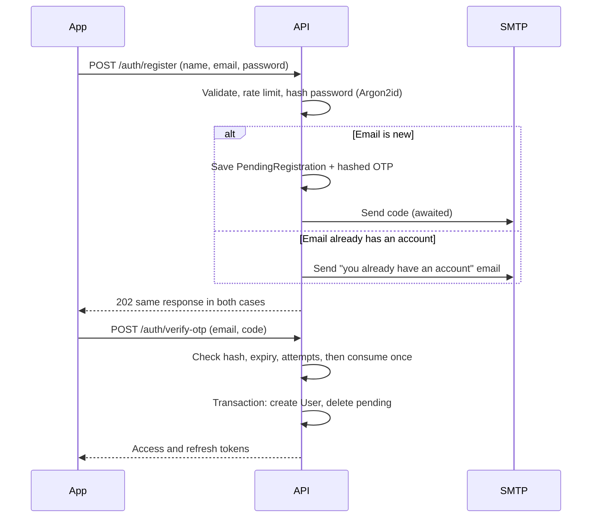

# 08. Backend and Auth

## Auth overview

Both login methods end the same way: the backend issues **our own** tokens.

| Token | Format | Lifetime | Stored |
|---|---|---|---|
| Access | JWT, signed with `jose` | 15 minutes | Device memory |
| Refresh | Random 256-bit, opaque | 90 days, rotates on each use | Device: `expo-secure-store`. Server: SHA-256 hash only |

## Register with email and OTP



**Why a separate pending table:** if unverified accounts lived in `User`, an attacker could register your email with their password before you ever signed up. When you later use Google with that email, the accounts would link and the attacker's password would still work. With a pending table, no user exists until the email's owner proves it.

### OTP rules

| Rule | Value |
|---|---|
| Code | 6 digits from a cryptographic random source |
| Storage | `HMAC-SHA256(OTP_PEPPER, email + purpose + code)`, never plain text |
| Expiry | 10 minutes |
| Attempts | 5, then the code is dead |
| Use | Once. Consumption is an atomic `UPDATE ... WHERE consumedAt IS NULL` |
| Resend | Every 60 seconds. A new code invalidates older ones |
| Limits | 5 sends per hour per email, 20 per hour per IP |
| Comparison | Constant-time |

### Nodemailer

```ts
const transporter = nodemailer.createTransport({
  host: env.SMTP_HOST,
  port: 587,
  secure: false,        // upgrades with STARTTLS
  requireTLS: true,
  auth: { user: env.SMTP_USER, pass: env.SMTP_PASS },
  // No pool: serverless functions shouldn't hold connections
  connectionTimeout: 10_000,
  socketTimeout: 10_000,
});
```

- **Always `await` the send** inside the request, since a serverless function may freeze after responding. If the send fails, invalidate the code and return an error the user can retry.
- **Starting choice:** Gmail with an App Password (requires 2-Step Verification). Fine for personal use. It's limited to low volume, and Google may block unusual IPs such as Vercel's. If codes stop arriving, change only the SMTP env vars to a transactional provider with a real SMTP endpoint (Resend, Postmark, SES). Nodemailer stays the same.
- Email contains the code, its expiry and "ignore this if it wasn't you". Plain text + simple HTML.

## Login with email

`POST /auth/login` returns the same error for "wrong password" and "no such user". Argon2id runs either way, using a dummy hash for unknown users, so response timing doesn't reveal which emails exist. Limits: 10 attempts per 15 minutes per email + IP.

Password: 8 to 128 characters. Argon2id through `@node-rs/argon2` (prebuilt binary, works on Vercel). No forced symbol rules.

## Sign in with Google

1. App uses `@react-native-google-signin/google-signin` and gets a Google ID token.
2. `POST /auth/google { idToken }`.
3. Backend verifies signature, `aud` (our web client ID), `iss`, expiry, `email_verified` with `google-auth-library`.
4. Find a user by `googleSub`. If none, find by verified email and link. If none, create one.
5. Issue our tokens.

**Setup trap:** Google Sign-In on Android requires OAuth clients registered with the right **SHA-1 fingerprints**. Debug, EAS and Play signing each have their own. Most "DEVELOPER_ERROR" failures come from this. Add all of them.

## Forgot password

Request code → verify OTP → set new password → **all refresh tokens are revoked**, so any stolen session dies. Response is the same whether the email exists or not.

## Refresh token rotation

Each use returns a new refresh token and retires the old one. Reuse of a retired token signals theft, so the whole family is revoked.

**Mobile trap:** on a bad connection, the server may rotate the token but the response never arrives. The phone retries with the "old" token, and a strict rule would log out a legitimate user. So:

- **30-second grace period:** reuse within 30 seconds issues a fresh token in the same family, rather than revoking it.
- **Single-flight on the client:** only one refresh call at a time, shared by all requests.
- The new token is written to secure storage before the old one is forgotten.
- **Only an explicit rejection (401) signs out of sync.** Network errors never clear tokens.

## API

Base path `/api/v1`. JSON, Bearer token, and errors shaped as `{ error: { code, message } }`.

### Auth

| Method | Path | Purpose |
|---|---|---|
| POST | `/auth/register` | Start registration, send OTP |
| POST | `/auth/verify-otp` | Finish registration |
| POST | `/auth/resend-otp` | Resend code |
| POST | `/auth/login` | Email login |
| POST | `/auth/google` | Google login |
| POST | `/auth/refresh` | Rotate tokens |
| POST | `/auth/logout` | Revoke this device's family |
| POST | `/auth/forgot-password` | Send reset code |
| POST | `/auth/reset-password` | Verify code, set password |

### Data

| Method | Path | Purpose |
|---|---|---|
| GET | `/me` | Profile and settings |
| PATCH | `/me` | Update profile and settings |
| DELETE | `/me` | Delete account and all data |
| PUT | `/activities/{id}` | Idempotent create or update |
| PATCH | `/activities/{id}` | Edit title, type, note |
| DELETE | `/activities/{id}` | Mark deleted |
| GET | `/activities/{id}/track` | Download route blob |
| GET | `/sync/changes?cursor=&limit=` | Pull changes |
| PUT | `/presets/{id}`, DELETE | Share presets |

### Other

| Method | Path | Purpose |
|---|---|---|
| GET | `/map-style?...` | Colored map style JSON, cacheable ([06-share-studio.md](06-share-studio.md)) |
| GET | `/config` | Tile and style URLs, minimum app version |
| GET | `/health` | Uptime check, including a `SELECT 1` |
| GET | `/internal/cleanup` | Cron only, protected by `CRON_SECRET` |

**`GET /config` matters more than it looks:** if OpenFreeMap ever changes or disappears, map URLs can change without shipping a new app. The app ships with safe defaults and caches the last value.

## Prisma + Neon setup

`prisma.config.ts`, used by the CLI, with the **direct** URL:

```ts
import 'dotenv/config';
import { defineConfig, env } from 'prisma/config';

export default defineConfig({
  schema: 'prisma/schema.prisma',
  migrations: { path: 'prisma/migrations' },
  datasource: { url: env('DATABASE_URL_UNPOOLED') },
});
```

`src/db.ts`, used by the app, with the **pooled** URL:

```ts
import { PrismaNeon } from '@prisma/adapter-neon';
import { PrismaClient } from '@/generated/prisma/client';

const adapter = new PrismaNeon({ connectionString: process.env.DATABASE_URL! });
const makeClient = () => new PrismaClient({ adapter });

const g = globalThis as unknown as { prisma?: PrismaClient };
export const prisma = g.prisma ?? makeClient();
if (process.env.NODE_ENV !== 'production') g.prisma = prisma;
```

Notes from Neon's guide:

- Pool settings like `connection_limit` in the URL do nothing with this adapter.
- The pooled host has `-pooler` in its name. **If migrations ever run against it, they can fail or hang.**
- Keep only one Prisma config file, because a stray duplicate can send migrations to the wrong URL.

Verify these snippets against the Prisma docs when scaffolding, as details can change between versions.

Neon may scale to zero when idle, so the first request can be slower. The app handles this: Sync waits with retries, and auth requests use a 15-second client timeout with a clear retry message.

## Environment variables

```bash
# Neon
DATABASE_URL=                # Pooled, has -pooler in host
DATABASE_URL_UNPOOLED=       # Direct, for migrations

# Tokens
JWT_SECRET=                  # 32+ random bytes
OTP_PEPPER=                  # 32+ random bytes, different from above
CRON_SECRET=

# Google
GOOGLE_WEB_CLIENT_ID=

# Email
SMTP_HOST=
SMTP_USER=
SMTP_PASS=
EMAIL_FROM="Cardiomen <you@example.com>"

# Monitoring
SENTRY_DSN=
```

Mobile (public, not secret): `EXPO_PUBLIC_API_URL`, `EXPO_PUBLIC_GOOGLE_WEB_CLIENT_ID`, `EXPO_PUBLIC_SENTRY_DSN`.

Never put secrets in `EXPO_PUBLIC_` variables, since they're readable in the app bundle. Commit only `.env.example`.

## Security checklist

- HTTPS only
- Every data query is filtered by `userId` from the verified token, **never** a user ID sent by the client
- Zod validation on all input, with size limits: metadata fields, 4 MB for track payloads, and sanity ranges for stats
- Refresh tokens and OTPs stored only as hashes. Passwords with Argon2id
- Logs never contain passwords, tokens, OTPs or coordinates
- Rate limits on all auth routes
- Location is sensitive personal data: all traffic encrypted, account deletion removes it fully (cascade), and GPX export provides your data
- Dependency audit in CI, and a security review before any public launch
